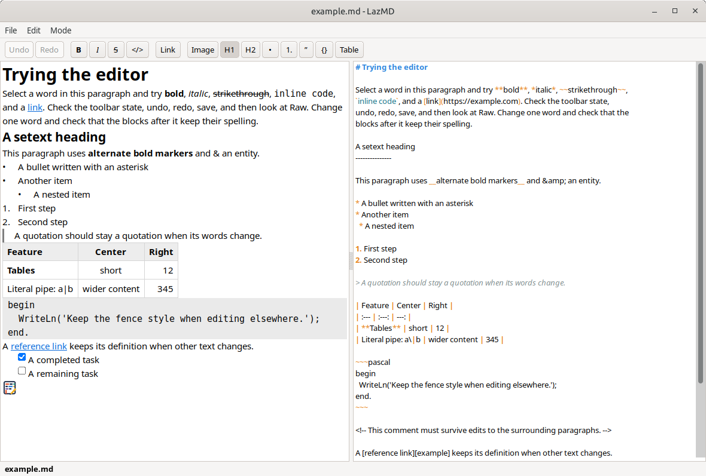
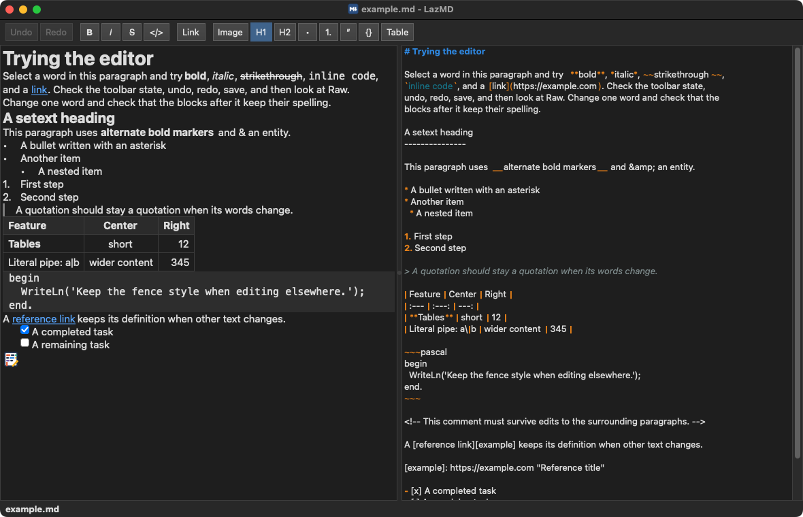

# LazMD

### A small Markdown editor for Linux, Windows and macOS.

Open a `.md` file and it shows rendered - headings, lists, tables, images,
code - and you edit it right there, the way you would in a word processor.
One document per window, in three modes from the **Mode** menu:

- **Rendered** (Ctrl+1) — type into the page itself. Ctrl+B, Ctrl+I and
  Ctrl+Shift+X for bold, italic and strikethrough, Ctrl+E for inline code,
  Ctrl+K for a link; toolbar buttons for those and for headings, lists,
  quotes, code blocks, tables and images. Task checkboxes toggle with a
  click. Ctrl+click follows a link: web links open in the browser, links to
  other Markdown files open in LazMD. Right-click, **Go to source**, shows
  the same spot in Raw.
- **Raw** (Ctrl+2) — the Markdown source, with syntax coloring.
- **Side by side** (Ctrl+3) — both at once, each following the other's
  edits.





LazMD keeps the file the way you wrote it. Opening, reading and saving
change nothing. An edit in Rendered rewrites only the paragraph, list or
table it touched; the rest of the file keeps its exact bytes - your choice
of `*` or `_`, reference links, comments, line endings and all.

**Image** inserts a picture: pick a file, see a preview, give it a
description, and either keep it where it is or copy it into a folder next
to the document, such as `images`. Paths are written relative to the
document once it has been saved.

Drop a file on the window to open it. When another program changes the
open file, LazMD reloads it and shows a short notice; if there are unsaved
edits, a bar above the text asks whether to reload or keep them. Nothing
modal opens.

Built with [LazInk](https://github.com/TonyStone31/LazInk) (rendering and
editing), [FileAss](https://github.com/TonyStone31/FileAss) (file
association), [FileEye](https://github.com/TonyStone31/FileEye) (file
change events) and [InfoBarToast](https://github.com/TonyStone31/InfoBarToast)
(the bar and the notices).

## Install

Download the file for your system from the
[latest release](https://github.com/TonyStone31/LazMD/releases/latest).
Each download is one or two megabytes: no installer, no dependencies to
fetch.

- **Linux** — `lazmd-linux-x86_64.zip`. Unzip and run `./lazmd`. Built on
  GTK3, which every current desktop has.
- **Windows** — `lazmd-windows-x86_64.zip`. Unzip and run `lazmd.exe`.
- **macOS** — `lazmd-macos.zip`. Unzip, drag `LazMD.app` to Applications.
  It is not signed, so the first time, right-click it and choose Open to
  get past Gatekeeper.

## Use it for Markdown files

**File → Open Markdown files with LazMD** registers the application and,
on Linux, makes it the default handler for `text/markdown`. The same from
a terminal:

```sh
./lazmd --register
./lazmd --unregister
```

Command line: `lazmd FILE` opens a file; each launch is its own window.

## Build

Free Pascal and Lazarus, with the [LazInk](https://github.com/TonyStone31/LazInk),
[FileAss](https://github.com/TonyStone31/FileAss),
[FileEye](https://github.com/TonyStone31/FileEye) and
[InfoBarToast](https://github.com/TonyStone31/InfoBarToast) repositories
checked out beside this one:

```sh
./build.sh            # Linux, zipped into dist/
./build.sh windows    # Windows, cross-built from Linux
./build-macos.sh app  # on a Mac: LazMD.app and its zip
```

or open `lazmd.lpi` in Lazarus. The scripts build without debug
information and with smart linking, which is what keeps the downloads
small. The release builds were made with Lazarus 4.8 / FPC 3.2.4 on the
Mac and Lazarus trunk on Linux, where Windows is cross-built; the source
builds on either.

`tests/run.sh` runs the checks; `tests/README.md` says how.

## Tested on

Linux Mint with GTK3; Windows 10, in a virtual machine; macOS Sequoia 15 on
Intel, in a virtual machine, light and dark mode, where a Markdown file
handed to the bundle by Finder opens in it. Apple Silicon has not been
tried.

## License

[0BSD](LICENSE).
